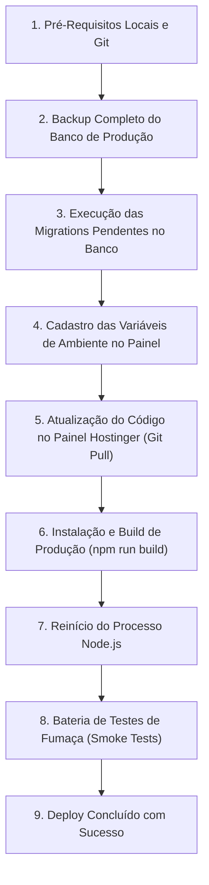

# TREVO ONE — PROCEDIMENTO OPERACIONAL PADRÃO DE DEPLOY NA HOSTINGER
## Guia de Publicação em Produção e Checklist à Prova de Falhas

Este documento estabelece o **passo a passo definitivo, sequencial e obrigatório** para realizar o deploy manual de novas versões do Trevo One na infraestrutura da **Hostinger Business Node.js**.

> [!IMPORTANT]
> **REGRA DE DEPLOY MANUAL**: Como o projeto não utiliza pipelines de CI/CD automáticos (GitHub Actions, webhooks de auto-deploy), a publicação em produção depende estritamente do cumprimento fiel da ordem das etapas descritas neste documento. **Nunca execute passos fora de ordem.**

---

## 1. Visão Geral dos Riscos do Deploy Manual

Como este é um processo 100% manual, entender os pontos de falha evita desastres em produção:

| Ponto de Risco Crítico | O que acontece se errar? | Como evitar? |
|---|---|---|
| **Deploy de código ANTES da migration** | 💥 **Falha Geral Imediata:** O código novo tenta ler/escrever em colunas ou tabelas que ainda não existem (`ER_NO_SUCH_TABLE`, `ER_BAD_FIELD_ERROR`). Alunos e administradores veem telas de erro 500 no carregamento. | **SEMPRE execute e confirme as migrations do banco ANTES de dar o pull/build do código novo.** |
| **Esquecer o backup prévio do banco** | 💥 **Sem Contingência:** Se uma migration travar no meio (ex: timeout de rede no phpMyAdmin) e corromper uma tabela, não há como voltar atrás sem perda de dados. | **Exporte o dump SQL no phpMyAdmin ou Hostinger Backups antes de qualquer `ALTER TABLE`.** |
| **Ambiente Asaas Incompatível (`ASAAS_ENVIRONMENT`)** | 💥 **Rejeição de Pagamento:** Se a chave de API cadastrada for do ambiente de produção mas a variável estiver como `sandbox` (ou vice-versa), o Asaas rejeita com `401 Unauthorized`. Se ficar em `sandbox` na virada real, pagamentos reais não serão processados. | **Conferir paridade estrita: chave de Sandbox com `ASAAS_ENVIRONMENT=sandbox`; chave de Produção com `ASAAS_ENVIRONMENT=production`.** |
| **Não reiniciar o processo Node na Hostinger** | ⚠️ **Ilusão de Deploy:** O Git atualiza os arquivos em disco, o build roda, mas o processo Node.js anterior continua rodando em memória com a versão velha. O usuário acha que o bug não foi corrigido. | **SEMPRE clicar no botão "Reiniciar Aplicação" (Restart) no painel Node.js da Hostinger após o build.** |
| **Reaproveitamento de segredos de autenticação** | ⚠️ **Vulnerabilidade de Segurança:** Usar o mesmo token para Webhook e Reprocessamento de Órfãos permite que um webhook forje rotas internas administrativas. | **Gere segredos independentes para `ASAAS_WEBHOOK_TOKEN` e `ASAAS_REPROCESS_CRON_SECRET`.** |

---

## 2. Ordem Oficial e Obrigatória das Etapas

A estratégia adotada pelo Trevo One é **Expand and Contract (Banco Primeiro, Código Depois)**:



### Por que as Migrations DEVEM rodar ANTES do Código?
1. **Retrocompatibilidade Aditiva**: As migrations do Trevo One (como a `074` e a `075`) são projetadas para serem puramente aditivas (`CREATE TABLE IF NOT EXISTS`, `ADD COLUMN ... NULL DEFAULT NULL`).
2. **Segurança do Código Legado**: Enquanto a migration roda, o código antigo que ainda está no ar continuará funcionando 100% normalmente, pois ele ignora as novas colunas e tabelas criadas.
3. **Imunidade a Erros no Novo Código**: Quando o novo código finalmente subir e for reiniciado, a estrutura de banco de dados que ele precisa já estará pronta e disponível para recebê-lo.

---

## 3. Pré-Requisitos Antes de Iniciar

Não inicie o deploy na Hostinger sem confirmar cada um dos itens abaixo:

- [ ] **Testes locais 100% aprovados:**
  - `npm run lint` (0 erros)
  - `npm run qa:full` (todos os 215+ testes passando)
  - `npm run build` (Next.js compilando sem falhas)
- [ ] **Branch de trabalho mergeada na `main`:**
  - A Hostinger puxa o código da branch de produção (geralmente `main`).
  - Faça o merge de `feat/asaas-pilot-saiya-shape` para `main` no GitHub e faça o push (`git push origin main`).
- [ ] **Janela de manutenção definida:**
  - Dê preferência a horários de menor atividade (ex: após as 22h ou início da manhã).
- [ ] **Acesso administrativo ao painel hPanel da Hostinger:**
  - Acesso ao painel da hospedagem Business, phpMyAdmin e seção de gerenciamento Node.js.

---

## 4. Etapa 1: Backup Completo do Banco de Produção (OBRIGATÓRIO)

**NUNCA execute migrations em produção sem antes extrair um dump completo.**

### Como fazer o backup via phpMyAdmin:
1. Acesse o **hPanel da Hostinger** -> **Bancos de Dados** -> **phpMyAdmin** (ao lado do banco de produção do Trevo One).
2. No menu superior do phpMyAdmin, clique na aba **Exportar** (*Export*).
3. Selecione o método de exportação: **Rápido - exibir apenas as opções mínimas**.
4. Formato: **SQL**.
5. Clique em **Exportar** e faça o download do arquivo `.sql`.
6. Renomeie o arquivo baixado com carimbo de data/hora seguro, por exemplo:
   `trevo_one_prod_backup_pre_deploy_YYYYMMDD_HHMM.sql`
7. Guarde esse arquivo em uma pasta segura no seu computador local.

---

## 5. Etapa 2: Execução das Migrations Pendentes no Banco

### Migrations a aplicar nesta virada:
- `074_rebuild_consultancy_forms.sql` (se ainda não aplicada em produção)
- `075_asaas_integration.sql`

### Como rodar as migrations com segurança no phpMyAdmin:
1. No **phpMyAdmin**, certifique-se de que o banco de dados correto está selecionado na barra lateral esquerda.
2. Clique na aba **Importar** (*Import*).
3. Em *Arquivo a importar*, clique em **Escolher arquivo** e selecione `database/migrations/075_asaas_integration.sql`.
4. Deixe as opções padrão de charset (`utf-8`) e clique em **Executar** (*Go*).
5. Aguarde a mensagem verde: `Importação realizada com sucesso`.

### Verificação pós-migration (SQL de Conferência):
Execute a consulta abaixo na aba **SQL** do phpMyAdmin para certificar que as novas tabelas e colunas foram consolidadas:

```sql
-- 1. Conferir se as novas tabelas do Asaas e Formulários existem
SHOW TABLES LIKE 'asaas_%';
SHOW TABLES LIKE 'consultancy_form%';

-- 2. Conferir colunas adicionadas no faturamento
SHOW COLUMNS FROM student_charges LIKE 'asaas_%';
SHOW COLUMNS FROM student_payments LIKE 'refunded_at';
SHOW COLUMNS FROM consultancy_finance_settings LIKE 'asaas_%';
```
*Critério de Aceite:*
- Devem existir as tabelas `asaas_customers`, `asaas_webhook_events`, `consultancy_forms`, `consultancy_form_assignments`.
- As colunas `asaas_payment_id`, `payment_method`, `asaas_invoice_url` devem constar em `student_charges`.
- A coluna `refunded_at` deve constar em `student_payments`.

---

## 6. Etapa 3: Cadastro de Variáveis de Ambiente no Painel da Hostinger

Acesse o **hPanel da Hostinger** -> Gerenciador de Hospedagem -> **Node.js** -> **Environment Variables** (ou edite o arquivo seguro `.env.local` na raiz do projeto via Gerenciador de Arquivos):

Cadastre/atualize as variáveis abaixo:

| Variável | Valor para Piloto (Sandbox) | Valor para Virada Real (Produção) | Observações |
|---|---|---|---|
| `ASAAS_API_KEY` | `$aact_...` *(chave do Asaas Sandbox)* | `$aact_...` *(chave do Asaas Produção)* | Chave da API Asaas. O Trevo One protege chaves com `$` contra expansão indevida. |
| `ASAAS_ENVIRONMENT` | `sandbox` | `production` | **Crítico:** Controla a URL base da API Asaas. |
| `ASAAS_WEBHOOK_TOKEN` | *Token secreto aleatório 64 chars* | *Token secreto aleatório 64 chars* | O mesmo token que será cadastrado no webhook do painel Asaas. |
| `ASAAS_REPROCESS_CRON_SECRET` | *Segredo alfanumérico 64 chars* | *Segredo alfanumérico 64 chars* | Segredo exclusivo para a rota `POST /api/internal/asaas-reprocess-orphans`. **Nunca** reutilizar o token do webhook. |
| `APP_URL` | `https://app.trevoone.com.br` | `https://app.trevoone.com.br` | URL canônica do domínio HTTPS do Trevo One. |

> [!WARNING]
> Salve as variáveis no painel da Hostinger. Se estiver editando o arquivo `.env.local` diretamente na Hostinger, garanta que o arquivo possui quebras de linha padrão Unix (LF) e não contém espaços em volta do sinal `=`.

---

## 7. Etapa 4: Atualização do Código, Build e Reinício (hPanel)

### Passo a passo no painel da Hostinger:
1. Acesse **hPanel** -> **Aplicações / Node.js** (ou aba **Git**).
2. **Puxar o código atualizado:**
   - Na seção **Git**, confirme que o repositório aponta para a branch `main`.
   - Clique em **"Puxar alterações" / "Pull"** (ou faça o deploy do commit mais recente).
   - Confirme que o commit exibido na tela bate com o commit de merge da branch `feat/asaas-pilot-saiya-shape`.
3. **Instalação e Build de Produção:**
   - No terminal SSH da Hostinger (ou painel de comandos do Node.js):
     ```bash
     npm install
     npm run build
     ```
   - Aguarde o build terminar com a mensagem `Compiled successfully` e `Generating static pages (25/25)`.
4. **Reiniciar a Aplicação Node.js:**
   - No topo do painel Node.js da Hostinger, localize o botão **"Reiniciar Aplicação"** (*Restart*).
   - Clique em **Reiniciar** e aguarde o status voltar para `Online / Running` (verde).

---

## 8. Etapa 5: Configuração do Webhook no Painel do Asaas

Com a aplicação no ar na Hostinger:
1. Acesse o painel do Asaas (Sandbox para o piloto, ou Produção na virada real).
2. Vá em **Configurações da Conta** -> **Integrações** -> **Webhooks para Cobranças**.
3. Configure os campos:
   - **URL do Webhook:** `https://app.trevoone.com.br/api/webhooks/asaas` *(substitua pelo seu domínio oficial HTTPS)*
   - **Versão da API:** `v3`
   - **Tipo de Envio:** `Não Sequencial` (Paralelo)
   - **Token de Autenticação:** Cole exatamente o mesmo valor cadastrado na variável `ASAAS_WEBHOOK_TOKEN` no painel da Hostinger.
   - **Eventos Selecionados:**
     - `PAYMENT_RECEIVED`
     - `PAYMENT_CONFIRMED`
     - `PAYMENT_REFUNDED`
4. Clique em **Salvar**.
5. Clique em **"Testar Webhook"** no painel do Asaas e confirme se o Asaas recebeu status `200 OK`.

---

## 9. Etapa 6: Ativação Controlada da Consultoria Saiya Shape no Banco

Por segurança, todas as consultorias nascem com o Asaas desativado (`asaas_enabled = 0`).
Para ligar o piloto exclusivamente na **Saiya Shape**:

No **phpMyAdmin**, execute:
```sql
UPDATE consultancy_finance_settings
SET asaas_enabled = 1,
    asaas_environment = 'SANDBOX', -- Alterar para 'PRODUCTION' no dia da virada real
    updated_at = CURRENT_TIMESTAMP(3)
WHERE consultancy_id = (SELECT id FROM consultancies WHERE slug = 'saiya-shape');
```

Confirme que **apenas a Saiya Shape** foi ativada:
```sql
SELECT c.slug, c.name, cfs.asaas_enabled, cfs.asaas_environment
FROM consultancies c
LEFT JOIN consultancy_finance_settings cfs ON cfs.consultancy_id = c.id;
```
*Critério de Aceite:* Apenas `saiya-shape` deve retornar `asaas_enabled = 1`. Todas as demais devem estar em `0` ou `NULL`.

---

## 10. Etapa 7: Bateria de Testes de Fumaça (Smoke Tests Pós-Deploy)

Abra o navegador em modo anônimo (para evitar cache residual de sessões anteriores) e siga a lista de verificação:

- [ ] **1. Disponibilidade Global:** Acessar a home `https://app.trevoone.com.br/login` — carregar sem tela em branco (HTTP 200).
- [ ] **2. Login e Autenticação:** Fazer login com conta administrativa e confirmar redirecionamento correto.
- [ ] **3. Teste do Bug Corrigido (Formulários em Rascunho / up.phone):**
  - Acessar `Saiya Shape` -> `Membros & Alunos` -> Selecionar um aluno (ex: Daien Silva) -> Aba **Formulários**.
  - Clicar em **"Novo formulário"** -> **"Escolher modelo existente"**.
  - Verificar se modelos em rascunho aparecem com rótulo `— (Rascunho)` e podem ser selecionados.
  - Clicar em **"Atribuir Formulário"**.
  - **Critério de Sucesso:** A atribuição é realizada com sucesso, o modal fecha, a lista de formulários do aluno atualiza e **nenhum erro de `Unknown column 'up.phone'` aparece na tela**.
- [ ] **4. Teste de Cobrança Asaas (Financeiro):**
  - Acessar o Financeiro da Saiya Shape.
  - Criar uma nova cobrança de teste de R$ 5,00 para um aluno teste via Pix.
  - Confirmar que o sistema exibe o QR Code Pix e o botão "Copiar código Pix".
  - Conferir no painel do Asaas se a cobrança foi registrada na lista de cobranças.
- [ ] **5. Teste de Webhook em Tempo Real:**
  - No painel do Asaas Sandbox, acionar a simulação de pagamento ("Confirmar Pagamento").
  - Atualizar a tela no Trevo One e confirmar que o status da cobrança mudou automaticamente para **Pago / Confirmado**.

---

## 11. Plano de Rollback e Contingência (Se algo falhar)

Se ocorrer qualquer falha impeditiva durante ou logo após o deploy, aplique o rollback na ordem abaixo:

### Nível 1: Falha apenas no faturamento Asaas (< 5 segundos)
Se o problema for apenas no gateway Asaas e o resto do sistema estiver funcionando:
```sql
UPDATE consultancy_finance_settings
SET asaas_enabled = 0,
    updated_at = CURRENT_TIMESTAMP(3)
WHERE consultancy_id = (SELECT id FROM consultancies WHERE slug = 'saiya-shape');
```
*Efeito:* A Saiya Shape volta instantaneamente a usar o fluxo legado de **Pix Manual com comprovante**. Nenhuma tela do aluno quebra.

### Nível 2: Falha no código do deploy (Reversão de Commit)
Se o novo código apresentar erros gerais de interface ou runtime:
1. No painel Git da Hostinger, selecione o commit anterior estável (ou reverta a `main` no GitHub via `git revert HEAD` e dê push).
2. Clique em **Pull / Deploy** na Hostinger.
3. Rode `npm run build` e clique em **Reiniciar Aplicação**.
*(Como as migrations do banco são puramente aditivas, o código anterior funcionará normalmente mesmo com as novas tabelas e colunas presentes no banco).*

### Nível 3: Falha de corrupção de banco (Restauração do Backup)
Em caso extremo de inconsistência nos dados:
1. No phpMyAdmin da Hostinger, selecione o banco de dados.
2. Vá na aba **Importar**.
3. Selecione o arquivo de backup gerado na Etapa 1 (`trevo_one_prod_backup_pre_deploy_...sql`).
4. Clique em **Executar** para restaurar o estado original.
