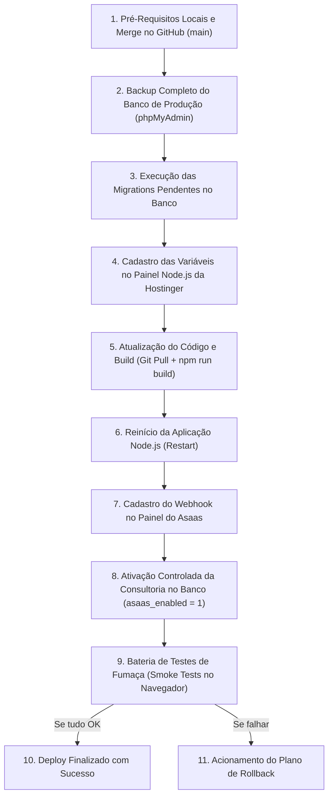

# TREVO ONE — PROCEDIMENTO OPERACIONAL PADRÃO DE DEPLOY NA HOSTINGER
## Guia de Publicação em Produção e Checklist à Prova de Falhas

Este documento estabelece o **passo a passo definitivo, sequencial e obrigatório** para realizar o deploy manual de novas versões do Trevo One na infraestrutura da **Hostinger Business Node.js**.

> [!IMPORTANT]
> **REGRA DE DEPLOY MANUAL**: Como o projeto não utiliza pipelines de CI/CD automáticos (GitHub Actions, webhooks de auto-deploy), a publicação em produção depende estritamente do cumprimento fiel da ordem das etapas descritas neste documento. **Nunca execute passos fora de ordem.**

---

## 1. Visão Geral dos Riscos do Deploy Manual

Como este é um processo 100% manual, entender os pontos de falha evita desastres em produção:

| Ponto de Risco Crítico | O que acontece se errar? | Como evitar? |
|---|---|---|
| **Deploy de código ANTES da migration** | 💥 **Falha Geral Imediata:** O código novo tenta ler/escrever em colunas ou tabelas que ainda não existem (`ER_NO_SUCH_TABLE`, `ER_BAD_FIELD_ERROR`). Alunos e administradores veem telas de erro 500 no carregamento. | **SEMPRE execute e confirme as migrations do banco ANTES de dar o pull/build do código novo.** |
| **Esquecer o backup prévio do banco** | 💥 **Sem Contingência:** Se uma migration travar no meio (ex: timeout de rede no phpMyAdmin) e corromper uma tabela, não há como voltar atrás sem perda de dados. | **Exporte o dump SQL no phpMyAdmin antes de qualquer `ALTER TABLE`.** |
| **Ambiente Asaas Incompatível (`ASAAS_ENVIRONMENT` / `ASAAS_PRODUCTION_CONFIRMED`)** | 💥 **Rejeição de Pagamento:** Se a chave de API cadastrada for de produção mas as variáveis estiverem como `sandbox` ou sem `ASAAS_PRODUCTION_CONFIRMED=true`, o sistema operará em sandbox por segurança. Se a chave for de sandbox em produção, o Asaas rejeita com `401 Unauthorized`. | **Conferir paridade estrita: chave de Sandbox com `ASAAS_ENVIRONMENT=sandbox`; chave de Produção com `ASAAS_ENVIRONMENT=production` E `ASAAS_PRODUCTION_CONFIRMED=true`.** |
| **Não reiniciar o processo Node na Hostinger** | ⚠️ **Ilusão de Deploy:** O Git atualiza os arquivos em disco, o build roda, mas o processo Node.js anterior continua rodando em memória com a versão velha. O usuário acha que o bug não foi corrigido. | **SEMPRE clicar no botão "Reiniciar Aplicação" (Restart) no painel Node.js da Hostinger após o build.** |
| **Reaproveitamento de segredos de autenticação** | ⚠️ **Vulnerabilidade de Segurança:** Usar o mesmo token para Webhook e Reprocessamento de Órfãos permite que um webhook forje rotas internas administrativas. | **Gere segredos independentes para `ASAAS_WEBHOOK_TOKEN` e `ASAAS_REPROCESS_CRON_SECRET`.** |

---

## 2. Ordem Oficial e Obrigatória das Etapas

A estratégia adotada pelo Trevo One é **Expand and Contract (Banco Primeiro, Código Depois)**:



### Por que as Migrations DEVEM rodar ANTES do Código?
1. **Retrocompatibilidade Aditiva**: As migrations do Trevo One (como a `074` e a `075`) são projetadas para serem puramente aditivas (`CREATE TABLE IF NOT EXISTS`, `ADD COLUMN ... NULL DEFAULT NULL`).
2. **Segurança do Código Legado**: Enquanto a migration roda, o código antigo que ainda está no ar continuará funcionando 100% normalmente, pois ele ignora as novas colunas e tabelas criadas.
3. **Imunidade a Erros no Novo Código**: Quando o novo código finalmente subir e for reiniciado, a estrutura de banco de dados que ele precisa já estará pronta e disponível para recebê-lo.

---

## 3. Pré-Requisitos Antes de Iniciar

Não inicie o deploy na Hostinger sem confirmar cada um dos itens abaixo:

- [ ] **Testes locais 100% aprovados:**
  - `npm run lint` (0 erros)
  - `npm run qa:full` (todos os 215+ testes passando)
  - `npm run build` (Next.js compilando sem falhas)
- [ ] **Branch de trabalho mergeada na `main`:**
  - A Hostinger puxa o código da branch de produção (`main`).
  - Faça o merge de `feat/asaas-pilot-saiya-shape` para `main` no GitHub e faça o push (`git push origin main`).
- [ ] **Janela de manutenção definida:**
  - Dê preferência a horários de menor atividade (ex: após as 22h ou início da manhã).
- [ ] **Acesso administrativo ao painel hPanel da Hostinger:**
  - Acesso ao painel da hospedagem Business, phpMyAdmin e seção de gerenciamento Node.js.

---

## 4. Etapa 1: Backup Completo do Banco de Produção (OBRIGATÓRIO)

**NUNCA execute migrations em produção sem antes extrair um dump completo.**

### Como fazer o backup via phpMyAdmin:
1. Acesse o **hPanel da Hostinger** -> **Bancos de Dados** -> **phpMyAdmin** (ao lado do banco de produção do Trevo One).
2. No menu superior do phpMyAdmin, clique na aba **Exportar** (*Export*).
3. Selecione o método de exportação: **Rápido - exibir apenas as opções mínimas**.
4. Formato: **SQL**.
5. Clique em **Exportar** e faça o download do arquivo `.sql`.
6. Renomeie o arquivo baixado com carimbo de data/hora seguro, por exemplo:
   `trevo_one_prod_backup_pre_deploy_YYYYMMDD_HHMM.sql`
7. Guarde esse arquivo em uma pasta segura no seu computador local.

---

## 5. Etapa 2: Execução das Migrations Pendentes no Banco

### Migrations a aplicar nesta virada:
- `074_rebuild_consultancy_forms.sql` (se ainda não aplicada em produção)
- `075_asaas_integration.sql`

### Como rodar as migrations com segurança no phpMyAdmin:
1. No **phpMyAdmin**, certifique-se de que o banco de dados de produção está selecionado na barra lateral esquerda.
2. Clique na aba **Importar** (*Import*).
3. Em *Arquivo a importar*, clique em **Escolher arquivo** e selecione `database/migrations/075_asaas_integration.sql`.
4. Deixe as opções padrão de charset (`utf-8`) e clique em **Executar** (*Go*).
5. Aguarde a mensagem verde: `Importação realizada com sucesso`.

### Verificação pós-migration (SQL de Conferência):
Execute a consulta abaixo na aba **SQL** do phpMyAdmin para certificar que as novas tabelas e colunas foram consolidadas:

```sql
-- 1. Conferir se as novas tabelas do Asaas e Formulários existem
SHOW TABLES LIKE 'asaas_%';
SHOW TABLES LIKE 'consultancy_form%';

-- 2. Conferir colunas adicionadas no faturamento
SHOW COLUMNS FROM student_charges LIKE 'asaas_%';
SHOW COLUMNS FROM student_payments LIKE 'refunded_at';
SHOW COLUMNS FROM consultancy_finance_settings LIKE 'asaas_%';
```
*Critério de Aceite:*
- Devem existir as tabelas `asaas_customers`, `asaas_webhook_events`, `consultancy_forms`, `consultancy_form_assignments`.
- As colunas `asaas_payment_id`, `payment_method`, `asaas_invoice_url` devem constar em `student_charges`.
- A coluna `refunded_at` deve constar em `student_payments`.

---

## 6. Etapa 3: Cadastro de Variáveis de Ambiente no Painel da Hostinger

> [!IMPORTANT]
> **MÉTODO ÚNICO E OFICIAL DE CONFIGURAÇÃO**:
> O Trevo One em produção na Hostinger utiliza **exclusivamente o painel da Hostinger (hPanel -> Node.js -> aba Environment Variables)**. Não utilize arquivos `.env.local` manuais no servidor remoto (arquivos `.env.local` são estritamente locais de desenvolvimento e ignorados pelo Git). O painel da Hostinger injeta os valores diretamente no `process.env` do runtime Node.js com total isolamento e segurança.

No **hPanel da Hostinger** -> **Aplicações / Gerenciador Node.js** -> aba **Environment Variables**, cadastre as seguintes variáveis:

| Variável | Valor para Piloto (Sandbox) | Valor para Virada Real (Produção) | Observações |
|---|---|---|---|
| `ASAAS_API_KEY` | `$aact_...` *(chave do Asaas Sandbox)* | `$aact_...` *(chave do Asaas Produção)* | Chave da API Asaas. O Trevo One protege chaves que iniciam com `$` contra expansão indevida. |
| `ASAAS_ENVIRONMENT` | `sandbox` | `production` | **Crítico:** Controla se as chamadas apontam para sandbox ou produção. |
| `ASAAS_PRODUCTION_CONFIRMED` | *(não definir)* | `true` | **Dupla Confirmação de Segurança:** Somente quando `ASAAS_ENVIRONMENT=production` E `ASAAS_PRODUCTION_CONFIRMED=true`, as chamadas vão para `https://api.asaas.com/v3`. Caso contrário, mantém sandbox por segurança. |
| `ASAAS_WEBHOOK_TOKEN` | *Token secreto aleatório 64 chars* | *Token secreto aleatório 64 chars* | Token exclusivo que deve bater exatamente com o que for cadastrado no Asaas. |
| `ASAAS_REPROCESS_CRON_SECRET` | *Segredo alfanumérico 64 chars* | *Segredo alfanumérico 64 chars* | Segredo dedicado para a rota `POST /api/internal/asaas-reprocess-orphans`. **Nunca** reaproveitar o token do webhook. |
| `APP_URL` | `https://app.trevoone.com.br` | `https://app.trevoone.com.br` | URL canônica do domínio HTTPS do Trevo One. |

Clique em **Salvar Variáveis** no painel da Hostinger.

---

## 7. Etapa 4: Atualização do Código e Build de Produção

1. No **hPanel** -> **Aplicações / Node.js** -> seção **Git**:
   - Confirme que o repositório está configurado para a branch `main`.
   - Clique no botão **"Puxar alterações" / "Pull"** para baixar o código atualizado do GitHub.
   - Verifique se o hash do commit bate com o commit de merge da branch `feat/asaas-pilot-saiya-shape`.
2. **Executar a instalação e o build:**
   - No terminal SSH da Hostinger (ou painel de comandos do Node.js):
     ```bash
     npm install
     npm run build
     ```
   - Aguarde o build terminar com a mensagem `Compiled successfully` e geração das páginas estáticas.

---

## 8. Etapa 5: Reiniciar a Aplicação Node.js (Restart)

1. No topo da página de gerenciamento do Node.js no hPanel, clique no botão **"Reiniciar Aplicação"** (*Restart*).
2. Aguarde alguns segundos até o indicador de status confirmar que a aplicação está ativa (`Online / Running` em verde).

> [!NOTE]
> **Por que reiniciar agora?**
> A aplicação precisa estar online e reiniciada neste ponto para que a nova rota `/api/webhooks/asaas` passe a existir e responder a requisições com o novo `ASAAS_WEBHOOK_TOKEN`. Isso é obrigatório para a etapa seguinte.

---

## 9. Etapa 6: Cadastro do Webhook no Painel do Asaas

Agora que a aplicação está rodando na Hostinger e a rota do webhook existe:

1. Acesse o painel do Asaas (Sandbox para testes ou Produção na virada real).
2. Vá em **Configurações da Conta** -> **Integrações** -> **Webhooks para Cobranças**.
3. Preencha os campos exatamente como abaixo:
   - **URL do Webhook:** `https://app.trevoone.com.br/api/webhooks/asaas` *(ou a sua URL oficial de produção)*
   - **Versão da API:** `v3`
   - **Tipo de Envio:** `Não Sequencial` (Paralelo / Assíncrono)
   - **Token de Autenticação:** Cole o mesmo valor cadastrado na variável `ASAAS_WEBHOOK_TOKEN` no painel da Hostinger.
   - **Eventos Selecionados:**
     - `PAYMENT_RECEIVED`
     - `PAYMENT_CONFIRMED`
     - `PAYMENT_REFUNDED`
4. Clique em **Salvar**.
5. Clique no botão **"Testar Webhook"** no Asaas e confirme que o status retornado foi `200 OK`.

---

## 10. Etapa 7: Ativação Controlada da Consultoria Saiya Shape no Banco

Por padrão, a migration 075 define `asaas_enabled = 0` para todas as consultorias.
Para ativar o piloto exclusivamente na **Saiya Shape**:

No **phpMyAdmin**, execute:
```sql
UPDATE consultancy_finance_settings
SET asaas_enabled = 1,
    asaas_environment = 'SANDBOX', -- Alterar para 'PRODUCTION' no dia da virada com dinheiro real
    updated_at = CURRENT_TIMESTAMP(3)
WHERE consultancy_id = (SELECT id FROM consultancies WHERE slug = 'saiya-shape');
```

Confirme que **apenas a Saiya Shape** foi ativada:
```sql
SELECT c.slug, c.name, cfs.asaas_enabled, cfs.asaas_environment
FROM consultancies c
LEFT JOIN consultancy_finance_settings cfs ON cfs.consultancy_id = c.id;
```
*Critério de Aceite:* Apenas `saiya-shape` deve retornar `asaas_enabled = 1`. Todas as outras devem permanecer em `0` ou `NULL`.

---

## 11. Etapa 8: Bateria de Testes de Fumaça (Smoke Tests no Navegador)

Abra o navegador em **janela anônima** e execute a verificação sequencial:

- [ ] **1. Disponibilidade do Sistema:** Acessar a home `https://app.trevoone.com.br/login` — tela carrega com status 200 sem travamentos.
- [ ] **2. Login Administrativo:** Realizar login com credenciais de personal/admin da Saiya Shape.
- [ ] **3. Validação do Bug Corrigido (Formulários em Rascunho / up.phone):**
  - Acessar `Saiya Shape` -> `Membros & Alunos` -> Selecionar o aluno Daien Silva -> Aba **Formulários**.
  - Clicar em **"Novo formulário"** -> **"Escolher modelo existente"**.
  - Confirmar que modelos em rascunho aparecem com o rótulo `— (Rascunho)` e podem ser selecionados.
  - Clicar em **"Atribuir Formulário"**.
  - **Critério de Sucesso:** A atribuição ocorre sem erros, o modal fecha, o card do formulário aparece na lista do aluno e **zero erros de `Unknown column 'up.phone'` aparecem na tela**.
- [ ] **4. Teste de Emissão de Cobrança Pix Asaas:**
  - Acessar o Financeiro da Saiya Shape.
  - Criar uma nova cobrança teste de R$ 5,00 para um aluno de teste selecionando Pix.
  - Confirmar que a tela renderiza o QR Code Pix e o botão "Copiar código Pix".
  - Conferir no painel do Asaas se a cobrança consta na listagem com o `externalReference` correspondente.
- [ ] **5. Teste de Webhook e Baixa Automática:**
  - No painel do Asaas (Sandbox), clicar em "Confirmar Pagamento" no simulador oficial.
  - Atualizar o Trevo One e constatar que a cobrança mudou seu status automaticamente para **Pago / Confirmado**.

---

## 12. Etapa 9: Plano de Rollback e Contingência Completo

Se qualquer falha for detectada durante ou após o deploy (especialmente nos testes da Etapa 8), acione o nível de rollback apropriado, **sempre iniciando pelo Nível 1**:

> [!TIP]
> **REGRA DE OURO DO ROLLBACK**: O **Nível 1 (desligamento por flag)** resolve mais de 95% das inconsistências operacionais do piloto sem necessidade de mexer no código, sem novo build e com **zero impacto** sobre as demais consultorias da plataforma.

---

### Nível 1: Desativação Imediata da Consultoria (< 5 segundos de execução — PRIMEIRA ESCOLHA)
Se o sistema web estiver no ar e a aplicação estável, mas o gateway Asaas falhar na criação da cobrança, no retorno do Pix ou na recepção do webhook:
1. No **phpMyAdmin**, desative o Asaas instantaneamente para a Saiya Shape:
   ```sql
   UPDATE consultancy_finance_settings
   SET asaas_enabled = 0,
       updated_at = CURRENT_TIMESTAMP(3)
   WHERE consultancy_id = (SELECT id FROM consultancies WHERE slug = 'saiya-shape');
   ```
2. **Resultado Imediato e Seguro:**
   - A Saiya Shape volta **instantaneamente** a operar no fluxo legado de **Pix Manual com comprovante**.
   - Nenhuma cobrança quebra, nenhum aluno é bloqueado e nenhuma outra consultoria é afetada.
   - Não requer alteração de código, rebuild nem reinício do Node.js.

---

### Nível 2: Falha no código do deploy (Reversão de Commit via Git na Hostinger)
Se o código novo apresentar erro 500 geral, falha no build, quebra de layout ou instabilidade pós-restart:
1. **Reverter o merge no Git:**
   - No GitHub, reverta o merge commit na branch `main` (`git revert -m 1 <commit-hash>` ou via interface do GitHub / PR de reversão) e dê `git push origin main`.
2. **Puxar o código revertido na Hostinger:**
   - No painel da Hostinger (seção **Git**), clique em **"Puxar alterações" / "Pull"**.
3. **Recompilar e Reiniciar:**
   - Execute `npm run build` no terminal da Hostinger.
   - Clique em **"Reiniciar Aplicação"** (*Restart*) no painel Node.js.
4. **Preciso reverter a migration do banco?**
   - **NÃO.** As migrations `074` e `075` são 100% aditivas (`NULL DEFAULT NULL`). O código antigo que voltou a rodar continuará funcionando normalmente com as novas tabelas e colunas presentes no banco. O rollback de código é suficiente.

---

### Nível 2.5: Restauração ou Limpeza Seletiva das Tabelas do Asaas (Sem Afetar Outras Consultorias)
Se você precisar desfazer dados ou limpar o estado das cobranças do Asaas sem afetar o resto da plataforma:
1. **É tecnicamente viável restaurar apenas tabelas específicas? SIM.**
   - No phpMyAdmin, é possível exportar/importar **tabelas isoladas** em vez do banco inteiro (aba *Exportar* -> método *Personalizado* -> selecionar apenas `asaas_customers`, `asaas_webhook_events`, etc.).
2. **Limpeza seletiva das tabelas exclusivas do piloto (Zero impacto em outros dados):**
   Como `asaas_customers` e `asaas_webhook_events` são tabelas novas criadas para o piloto, limpá-las não remove alunos, treinos ou dietas do sistema:
   ```sql
   -- 1. Limpar eventos de webhook e vínculos Asaas de teste
   TRUNCATE TABLE asaas_webhook_events;
   DELETE FROM asaas_customers WHERE consultancy_id = (SELECT id FROM consultancies WHERE slug = 'saiya-shape');

   -- 2. Limpar referências do Asaas em cobranças de teste da Saiya Shape (mantendo histórico)
   UPDATE student_charges
   SET asaas_payment_id = NULL,
       asaas_invoice_url = NULL,
       asaas_status_raw = NULL,
       payment_method = 'MANUAL_PIX'
   WHERE consultancy_id = (SELECT id FROM consultancies WHERE slug = 'saiya-shape')
     AND asaas_payment_id IS NOT NULL;
   ```
   *Vantagem:* Esse procedimento isola 100% a intervenção na Saiya Shape e **preserva integralmente** todos os dados reais das demais consultorias ativas na plataforma.

---

### Nível 3: Falha Crítica com Restauração Completa do Banco (ÚLTIMO RECURSO CATASTRÓFICO)

> [!CAUTION]
> **PERIGO DE PERDA DE DADOS MULTI-TENANT (TODAS AS CONSULTORIAS)**:
> **ATENÇÃO:** Este procedimento restaura o banco de dados **INTEIRO** da plataforma, afetando **TODAS as consultorias**, não apenas a Saiya Shape.
> Qualquer dado real criado em **QUALQUER** lugar do sistema (novos alunos cadastrados em outras consultorias, treinos concluídos, pagamentos Pix manuais aprovados, check-ins de nutrição, mensagens de chat) entre o momento do backup pré-deploy e o momento da restauração **SERÁ PERDIDO PERMANENTEMENTE**.
> **O Nível 3 NUNCA deve ser acionado por problemas isolados no piloto Asaas.** Ele só deve ser cogitado em caso de falha catastrófica de infraestrutura ou corrupção física do banco que inviabilize o sistema inteiro e que os Níveis 1, 2 e 2.5 não consigam resolver.

Se a restauração catastrófica for estritamente necessária:
1. Acesse o **phpMyAdmin da Hostinger** e selecione o banco de dados de produção do Trevo One.
2. Na aba **Estrutura**, role até o final, clique em **Marcar todos** e, no menu suspenso, selecione **Eliminar (DROP)** -> Confirme a exclusão de todas as tabelas (o banco ficará vazio).
3. Clique na aba **Importar** (*Import*).
4. Em *Arquivo a importar*, selecione o arquivo de backup baixado na **Etapa 1** (`trevo_one_prod_backup_pre_deploy_...sql`).
5. Clique em **Executar** (*Go*) e aguarde a mensagem de sucesso da restauração.
6. Clique em **"Reiniciar Aplicação"** no painel Node.js da Hostinger para restabelecer os pools de conexão com o banco restaurado.
7. O banco volta ao estado em que se encontrava no momento exato do backup da Etapa 1.
